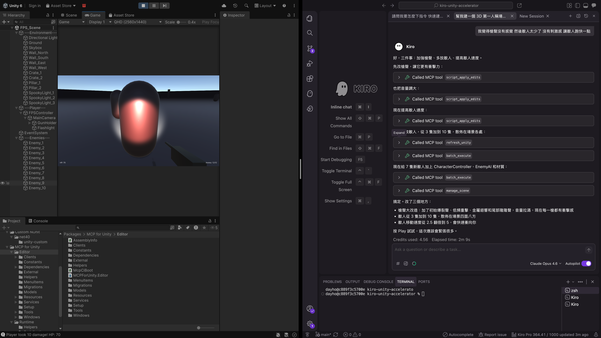
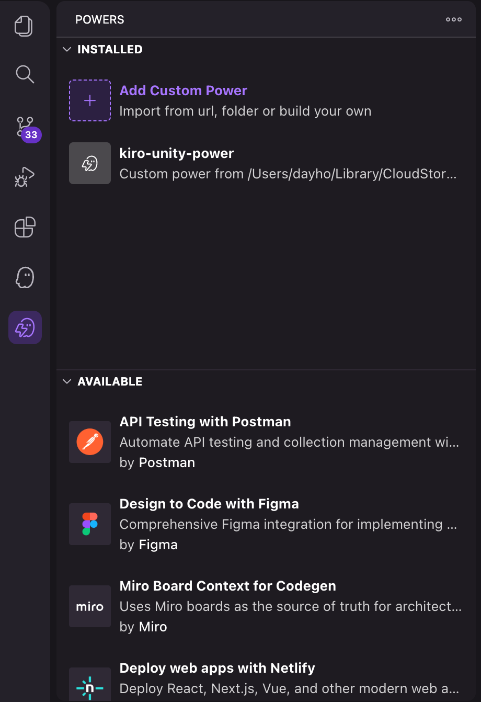
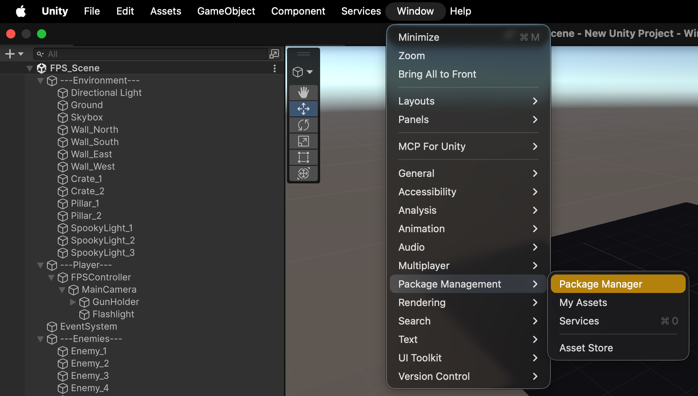
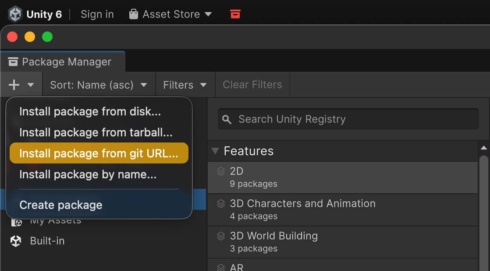
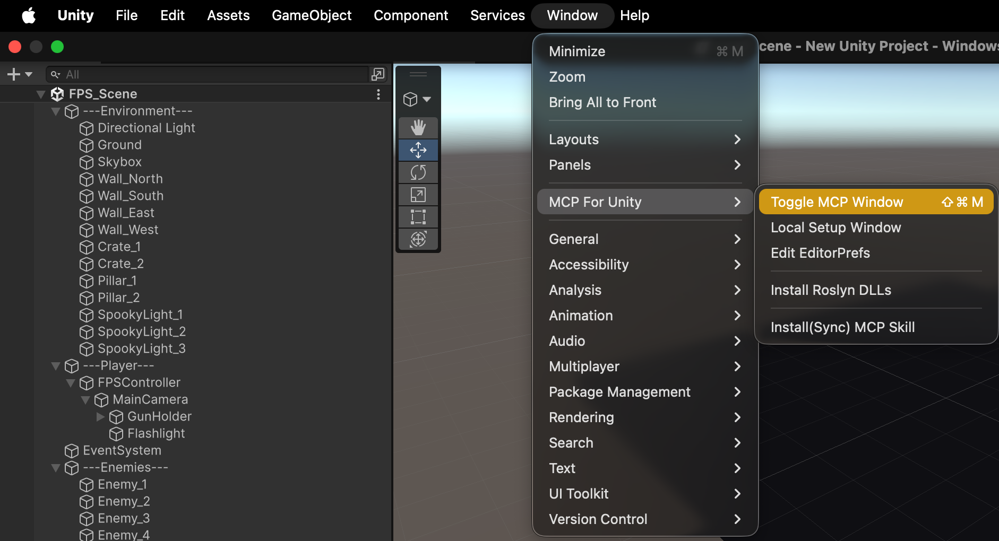
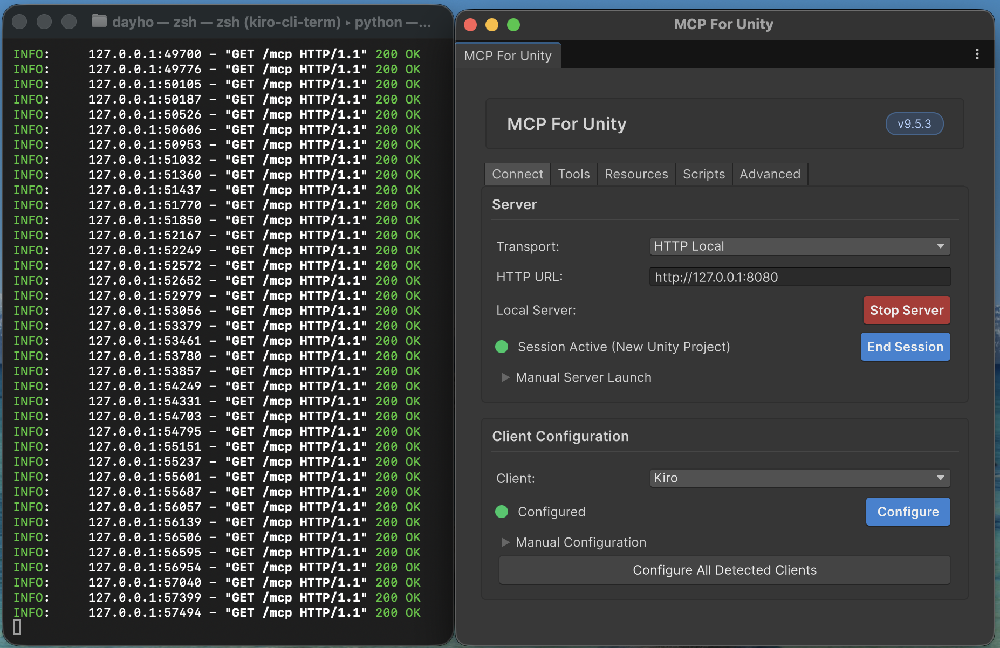

# Kiro Unity Accelerator

[English](README.md) | [繁體中文](README_ZH.md) | [简体中文](README_CN.md) | [日本語](README_JP.md) | [한국어](README_KR.md)

> **Note on language availability**: README files are available in 5 languages to support our global community. Examples and demo steps are intentionally parallel across all language versions for consistency — each version is human-reviewed for natural phrasing in that language. Steering files (domain knowledge) are in Traditional Chinese with English summary sections at the top of each file. The Power responds in the developer's preferred language, even though steering files are in Traditional Chinese with English summaries. If you encounter any language barriers, please open an issue for community support.

Transform your IDE into a Unity development AI assistant. Use natural language to command Unity Editor via MCP (Model Context Protocol — a standardized way for AI assistants to interact with development tools, allowing developers to describe what they want in plain language instead of manually navigating menus or writing boilerplate scripts). This Power covers asset management, scene building, build automation, performance analysis, code quality checks, and more — with 40+ TypeScript tool modules and 15 domain knowledge files.

> **Unity 6.4 baseline**: This Power targets **Unity 6.4** (release stream `6000.4`, newest patch `6000.4.12f1`, released 17 Jun 2026) and the tool surface of **MCP for Unity v10.3.0 or newer (minimum v10.0.0)**. The minimum Editor for this Power is **Unity 6.0 (`6000.0`)**; the bridge's own floor is lower (Unity 2021.3 LTS). The guidance was live-checked against **Unity `6000.4.6f1` + URP 17.4.0, Windows Editor, 2026-10-21**, first on MCP for Unity **9.6.8** and then again on **10.3.0** after the bridge was upgraded on the same machine (see [Upgrading the bridge](#upgrading-the-bridge-two-version-pins-you-must-keep-in-sync)) — Unity 6.5, 6.6 and later 6.x are expected to work but were **not** verified here. **Verified by direct calls on 10.3.0**: the running bridge version; the full **49-tool** inventory and the fact that the 9.6.8 → 10.3.0 delta is purely additive (6 tools added, **none removed or renamed**, so the upgrade carries no migration cost for this Power); the new `asset_gen` tool group, which is **off by default** and whose tools spend the developer's own third-party credits; all ten tool groups' membership and defaults; and the documented `manage_asset` / `find_gameobjects` / `manage_scene` contracts. A sixth round then exercised the **write path** on 10.3.0 — GameObject, component, prefab, script and asset-folder mutations, `refresh_unity`, and `run_tests` → `get_test_job` as a complete async job lifecycle — with every write confined to an isolated `Assets/_MCPVerify/` folder that was deleted afterwards, the project confirmed back at baseline (see [What the write path proved](#what-the-write-path-proved-and-the-one-finding-that-changes-how-you-chain-calls)). Still **not** verified: the six `asset_gen` tools (deliberately never called — they cost real money), `manage_build` (blocked by the verification machine's own permission rule), and `run_tests` against **actual tests** — the verification project has no test assemblies, so the job lifecycle is confirmed while **pass/fail reporting is not**. Unity 6.4 is an Update release and its patch stream ended 17 Jun 2026, so a project locking down for production should move to **Unity 6.3 LTS** (supported through Dec 2027) or forward onto the current Update release. **Unity 6.0 LTS support ended 16 Oct 2026 — it is never recommended, not even as a "safe older version".** Sources: [unity.com/releases](https://unity.com/releases/) and [endoflife.date/unity](https://endoflife.date/unity), both retrieved 2026-10-21.
>
> **What the 6.4-specific guidance covers**: URP **Render Graph is the only path** — URP Compatibility Mode and the `URP_COMPATIBILITY_MODE` scripting define were removed in 6.4, so it is no longer an escape hatch for legacy custom render passes; the GPU Resident Drawer (Forward+/Deferred+ GPU instancing, unavailable on the 2D Renderer) together with the redesigned Rendering Statistics window, which itemises which batching path absorbed each draw call instead of reporting one number; `InstanceID` deprecated in favour of `EntityId`, so an instance id returned by the bridge is an opaque token — pass it straight back, never do arithmetic on it, sort by it, or parse it; PVRTC removed on iOS (ASTC or ETC only); Web builds running `[BurstCompile]` jobs on background workers even though multithreaded *rendering* is still unavailable; a custom render pass can now be injected into the URP 2D frame loop; and the OculusXR package is deprecated in favour of the OpenXR plug-in, with HoloLens 2 support and its plug-in deprecated in 6.4 (the OculusXR removal release is unverified). Scripting backend: `manage_build` accepts **`mono` or `il2cpp` only** — CoreCLR cannot be selected through this Power. Sources: [New in Unity 6.4](https://docs.unity.com/en-us/engine/6000.6/manual/whats-new/unity64) and [Upgrade to Unity 6.4](https://docs.unity.com/en-us/engine/6000.6/manual/upgrade-guides/upgrade-guide-unity64), both retrieved 2026-10-21.
>
> Rather than trusting a remembered version number, the Power checks the connected project through MCP — `manage_graphics(action: "pipeline_get_info")` for the active render pipeline, the `mcpforunity://project/info` resource for the Unity version and platform, and `manage_packages(action: "list_packages")` for installed packages — before applying any version-specific advice.

> **Key Concepts**: Technical terms used throughout this document (if you are new to Unity development, these concepts will become clearer as you work through the examples — you do not need to understand them all upfront):
> - **MCP** (Model Context Protocol): A standardized protocol for AI assistants to communicate with development tools, enabling developers to use natural language to operate Unity Editor
> - **DAG** (Directed Acyclic Graph): A directed graph with no cycles, used to determine task dependency order (e.g., "import textures before creating materials")
> - **MVC** (Model-View-Controller): An architecture pattern that separates code into data (Model), display (View), and logic (Controller)
> - **ECS** (Entity-Component-System): Unity DOTS data-oriented architecture pattern for efficiently processing large numbers of objects (e.g., managing thousands of entities simultaneously)
> - **ScriptableObject**: Unity's serializable data container for storing configuration and shared data (without needing to attach to scene objects)
> - **AssetBundle**: Unity's asset packaging format for distribution and dynamic loading (reduces initial install size)



## Features

- **Asset Automation** — Batch apply asset presets, auto-detect asset types, generate change summaries
- **Scene Scaffolding** — One-command scene structure generation with conflict detection
- **Build Automation** — Local builds through `manage_build`, build log parsing, reusable build configuration templates
- **Cross-Platform Testing** — Test execution through `run_tests` / `get_test_job`, result formatting, test suite conversion
- **Workflow Automation** — Multi-step workflows with DAG dependency validation and topological execution
- **Performance Analysis** — Profiler screenshot analysis, code anti-pattern scanning, optimization recommendations
- **Code Quality** — MVC/ECS/ScriptableObject architecture checks, circular dependency detection
- **Knowledge Management** — Team documentation management, API change tracking, staleness detection
- **Platform Compatibility** — Shader compatibility, memory budget checks, severity classification (including XR/VR)
- **Asset Dependency Management** — Dependency trees, orphan asset detection, AssetBundle duplication checks
- **Level Design Tooling** — Editor extension script generation, ScriptableObject templates, batch scene object configuration
- **UI Dependency Analysis** — Cross-file UI reference tracking, event chain analysis, coupling assessment

## Architecture

```
Developer (Natural Language)
    → AI Layer (Intent Understanding & Planning)
        → MCP Protocol
            → Unity Editor (Execution Layer)

Unity Accelerator (Intelligence Layer)
├── POWER.md        → Main document defining tools & workflows
├── steering/       → 15 domain knowledge files
├── templates/      → Built-in templates (Presets, Scaffolds, Build Configs, etc.)
└── src/            → 40+ TypeScript tool modules
```

## Which "Unity MCP"? — three different projects

Three unrelated projects are called some variant of "Unity MCP". This Power targets **only the first one**. Mixing them produces tool names and ports that match nothing in this documentation. All three rows retrieved **2026-10-21**.

| Project | Identity | How it connects | Status |
|---|---|---|---|
| **(a) CoplayDev MCP for Unity** — *what this Power uses* | UPM `com.coplaydev.unity-mcp`, repo [CoplayDev/unity-mcp](https://github.com/CoplayDev/unity-mcp), Python server published on PyPI as `mcpforunityserver`, MIT-licensed | streamable HTTP (default) at `http://127.0.0.1:8080/mcp`, or stdio through `uvx`; the Unity-side bridge also listens on TCP `6400` | Active. Verified-current release **v10.3.0** (2026-10-04); this Power documents **v10.3.0 or newer, minimum v10.0.0**. **49** tool entrypoints across 10 groups — counted from a live `manage_tools(action: "list_groups")` call on 10.3.0, which is the authoritative number (upstream's README says 48) |
| **(b) IvanMurzak/Unity-MCP** — *a different project, not used here* | UPM `com.ivanmurzak.unity.mcp`, repo [IvanMurzak/Unity-MCP](https://github.com/IvanMurzak/Unity-MCP) | a separate server binary downloaded into `Library/mcp-server/`; its port is derived from a hash of the project path (range 20000–29999), so there is no port to configure | Active, latest 1.3.0 (~2026-10-20). Its tool names and port scheme do **not** match this Power |
| **(c) Unity's own in-Editor MCP server** | shipped inside `com.unity.ai.assistant`; UI at `Edit > Project Settings > AI > Unity MCP` | the MCP client connects straight to the in-Editor server | **Deprecated** — see below |

**On the deprecation of (c), and why it does not affect this Power.** Unity's documentation states that the MCP server inside the in-Editor AI assistant package is deprecated and that the Unity CLI (`unity mcp`) takes its place, shipping its own MCP server that speaks the same protocol ([Unity CLI as the replacement for the in-Editor MCP server](https://docs.unity.com/en-us/unity-cli/replace-mcp-server-unity-cli), retrieved 2026-10-21; the same notice appears in the package docs, [com.unity.ai.assistant — Get started with MCP server](https://docs.unity3d.com/Packages/com.unity.ai.assistant@2.18/manual/integration/unity-mcp-get-started.html), retrieved 2026-10-21). **The same Unity page states that third-party MCP packages installed from GitHub to give agents access to Unity are unaffected by that deprecation.** Project (a) — the bridge this Power uses — is therefore explicitly outside the scope of the deprecation, and this Power is not obsolete because of it.

## Prerequisites

- [Unity Editor](https://unity.com/) installed with a project open (see Setup alternatives below if you have restricted installation access) — Unity 6.4 is the target, Unity 6.0 the minimum for this Power
- [Kiro IDE](https://kiro.dev/docs/getting-started/installation) installed
- **MCP for Unity v10.3.0 or newer (minimum v10.0.0)** — if the project has `com.coplaydev.unity-mcp` 9.6.8 or older installed, upgrade it; the 9.6.8 → 10.3.0 change is purely additive, so there is no migration cost. Read [Upgrading the bridge](#upgrading-the-bridge-two-version-pins-you-must-keep-in-sync) before you start: the C# package and the Python server are pinned separately, and upgrading only one breaks the bridge
- **Python 3.10 or newer plus [`uv`](https://docs.astral.sh/uv/)** — the bridge's server is a Python package (`mcpforunityserver` on PyPI) launched through `uv`/`uvx`. The MCP for Unity setup wizard can install `uv` for you; on Windows, point "Choose UV Install Location" at the WinGet shim (`%LOCALAPPDATA%\Microsoft\WinGet\Links\uv.exe`) if several `uv.exe` copies are on PATH
- Node.js 18+ (for development/typechecking only — not required for basic usage with the Power)

> **Setup alternatives**: Choose the installation method that works for your environment:
> - **Standard setup**: Follow the steps below (requires unrestricted software installation access)
> - **Restricted environment**: See the Troubleshooting section for alternative configuration options (e.g., stdio transport mode — a method that runs the MCP server as a child process instead of using HTTP)
> - **Enterprise/managed environment**: If your organization manages software installations, consult your IT department about licensing and installation procedures
>
> Unity Editor offers a free Personal license for individuals, students, hobbyists, and small teams.

## Installation

### Step 1 — Install this Power in your IDE

Open Kiro → Left panel click Powers icon → Click "+" button → Select "Add Custom Power" → Select this project's root directory

> **Note**: The underlying Unity MCP tools ([CoplayDev/unity-mcp](https://github.com/CoplayDev/unity-mcp)) are open-source and can also be used independently with any MCP-compatible client.



### Step 2 — Install unity-mcp and Start MCP Server in Unity

1. Open Unity Editor → Window → Package Manager

   

2. Click "+" → "Add package from git URL..." → Paste the following URL and click Add. **Note the pinned `#v10.3.0` tag — do not replace it with `#main`:**

   ```
   https://github.com/CoplayDev/unity-mcp.git?path=/MCPForUnity#v10.3.0
   ```

   

   > **Corrected instruction.** Earlier versions of this README told you to use `...?path=/MCPForUnity#main`. That was wrong, and the failure it causes was **reproduced on a real install (verified 2026-10-21)**. Unity resolves a git UPM dependency **once** and then caches the resolved commit — a moving ref like `#main` does **not** track the branch. The verification machine's `Packages/manifest.json` said `#main` while the installed package was still **9.6.8** and upstream was already **10.3.0**: stranded for months with no update prompt anywhere in Package Manager. A months-old bridge no longer matches the tool surface this Power documents, which is a direct cause of "the AI can't drive Unity".

   Alternatives to the pinned git URL:

   - **OpenUPM**: `openupm add com.coplaydev.unity-mcp` — a registry install, so Package Manager offers an update when a newer version ships
   - **Asset Store**: the "MCP for Unity" listing, then Package Manager → My Assets

   **To upgrade later**, change the tag — that is what forces Unity to re-resolve. Either edit `Packages/manifest.json`:

   ```json
   "com.coplaydev.unity-mcp": "https://github.com/CoplayDev/unity-mcp.git?path=/MCPForUnity#v10.3.0"
   ```

   …or remove the package and re-add the git URL with the new tag. Then follow [Upgrading the bridge](#upgrading-the-bridge-two-version-pins-you-must-keep-in-sync) — the UPM package is only half of the upgrade.

3. On first import the package opens a **setup wizard**. The persistent UI afterwards is **Window → MCP for Unity**, which starts/stops the server, switches transport, and reconfigures clients.

   

   > The screenshot above was taken on an older build whose menu item read "Toggle MCP Window". Current builds use `Window → MCP for Unity`.

4. Confirm the status panel reads **Connected**, and read the server endpoint/port it displays — you will need that port below. `Restart Server` is the recovery action.

   

### Pick exactly one MCP registration path

Two different mechanisms can register the Unity MCP server with Kiro, and they write to the **same** config file under different names. Running both leaves two servers pointing at the same Unity Editor, which produces duplicate tool surfaces and ambiguous resource reads.

- **Path A — let this Power register the server.** Install the Power and leave its `mcp.json` alone. A Legacy (`POWER.md`) power's MCP servers are registered into `~/.kiro/settings/mcp.json` under the Powers section, with the server name namespaced by Kiro.
- **Path B — let Unity configure Kiro.** In Unity, `Window → MCP for Unity → Configure All Detected Clients` (or select Kiro and `Configure Selected`). The package writes a server entry named `unityMCP` into the same file.

> **If Kiro's MCP panel shows two Unity MCP servers, disable one and restart Kiro.** The three config locations that matter: this Power's own `mcp.json`, user-level `~/.kiro/settings/mcp.json`, and workspace-level `.kiro/settings/mcp.json`.

### MCP Connection Configuration

#### Automatic Configuration (Recommended)

In Unity, `Window → MCP for Unity` → confirm the transport is HTTP → **Configure All Detected Clients** (or select Kiro and **Configure Selected**). Kiro is a first-class supported client, so this writes a port-accurate entry into `~/.kiro/settings/mcp.json` under the server key `unityMCP`.

#### Read the real port

**Do not treat 8080 as a constant.** The port is whatever the server was launched with (`--http-url`), it is user-editable, and 8080 collides with other services (upstream names Tailscale as an example and suggests moving to 8090). The MCP for Unity window shows the live endpoint — if it is not 8080, the URL is `http://127.0.0.1:<that port>/mcp`.

You can also read the port straight off disk: the running server writes a pidfile named after its port under the Unity project.

```
<UnityProject>\Library\MCPForUnity\RunState\mcp_http_<port>.pid
```

So `mcp_http_8080.pid` means the server is serving `http://127.0.0.1:8080`. On the install this Power was verified against, that is exactly what was there — the server's own command line was `mcp-for-unity --transport http --http-url http://127.0.0.1:8080 --project-scoped-tools --pidfile ...mcp_http_8080.pid`.

#### Manual Configuration (last resort)

Edit `mcp.json` only if the two steps above did not produce a working entry.

HTTP mode (default transport — local-only, communicates with the Unity Editor on your machine):

> **Security Note**: HTTP is used intentionally here. The server binds loopback only (`127.0.0.1` / `::1`); binding a LAN address requires `Advanced Settings → Allow LAN Bind (HTTP Local)`, and a remote endpoint must be `https://`. Traffic on the default setup never leaves your machine, so HTTPS is not required.

```json
{
  "mcpServers": {
    "unity-mcp": {
      "url": "http://127.0.0.1:8080/mcp",
      "type": "http",
      "env": {},
      "disabled": false
    }
  }
}
```

> Replace `8080` with the port shown in the Unity window. The mode key is `type`, not `transport`. `127.0.0.1` is deliberate: upstream docs print `localhost`, but the Unity side's own default is the literal `127.0.0.1`, and on Windows `localhost` can resolve to `::1` first.

> **Connection methods**: HTTP (simpler, recommended) and stdio (backup option). Choose HTTP unless you hit a port conflict or a firewall.

Stdio mode (fallback — runs the MCP server as a subprocess, a separate process managed by Kiro). The PyPI distribution is **`mcpforunityserver`** and the console entrypoint is **`mcp-for-unity`**; `--transport stdio` is required. There is **no `unity-mcp` package on PyPI** — earlier versions of this README documented `uvx unity-mcp`, which is why that fallback never launched.

Windows (use an absolute `uvx.exe` path — the WinGet shim is the recommended one):

```json
{
  "mcpServers": {
    "unity-mcp": {
      "command": "C:/Users/<you>/AppData/Local/Microsoft/WinGet/Links/uvx.exe",
      "args": ["--from", "mcpforunityserver", "mcp-for-unity", "--transport", "stdio"],
      "type": "stdio",
      "env": {},
      "disabled": false
    }
  }
}
```

macOS/Linux (`uvx` on PATH is usually fine):

```json
{
  "mcpServers": {
    "unity-mcp": {
      "command": "uvx",
      "args": ["--from", "mcpforunityserver", "mcp-for-unity", "--transport", "stdio"],
      "type": "stdio",
      "env": {},
      "disabled": false
    }
  }
}
```

### Upgrading the bridge: two version pins you must keep in sync

MCP for Unity is **two components, each with its own separately pinned version**. This is the most confusing part of upgrading it, and all of the following was observed on a live 9.6.8 → 10.3.0 upgrade on **2026-10-21**.

| Component | What it is | Where its version is pinned |
|---|---|---|
| UPM package (C# editor side) | `com.coplaydev.unity-mcp` in your Unity project | `Packages/manifest.json` — the git tag, or the registry version |
| Python MCP server | PyPI distribution `mcpforunityserver`, entrypoint `mcp-for-unity` | the `--from "mcpforunityserver==<version>"` argument of the command line Unity launches |

The pre-upgrade launch line, observed verbatim:

```
uvx --from "mcpforunityserver==9.6.8" mcp-for-unity --transport http --http-url http://127.0.0.1:8080
  --project-scoped-tools --pidfile <UnityProject>\Library\MCPForUnity\RunState\mcp_http_8080.pid
  --unity-instance-token <token>
```

**Upgrading the UPM package does not upgrade the Python server.** After the manifest moved to `#v10.3.0` and Unity imported and compiled the v10.3.0 C# cleanly, the running server still reported version `9.6.8` — it was executing an older cached copy.

**The mismatch breaks the bridge selectively, which makes it very confusing.** With C# at 10.3.0 and Python at 9.6.8, every Unity-dependent tool call returned `{"success":false,"error":"Unity session not available; please retry","data":{"reason":"no_unity_session",...}}`, while server-only tools such as `debug_request_context` kept answering normally. The server looks alive; nothing that touches Unity works.

#### Upgrade procedure

1. **Change the UPM pin** — edit the tag in `Packages/manifest.json`, or remove and re-add the git URL with the new tag. A moving ref like `#main` will not re-resolve.
2. *Optional but recommended on a slow network:* **pre-seed the uv cache** with `uvx --from "mcpforunityserver==10.3.0" mcp-for-unity --help`. On the verified upgrade this is why Unity could then start the server with `--offline`.
3. **Let Unity import and compile** the package; confirm the editor log shows no `error CS`.
4. **Stop the stale server process chain** (`uvx` → `uv` → `mcp-for-unity` → `python`). It will not pick up the new version by itself.
5. **Delete the stale pidfile** if one is left behind at `<UnityProject>\Library\MCPForUnity\RunState\mcp_http_<port>.pid`. On the verified upgrade it was left there after the kill and had to be removed by hand.
6. **Start the server from Unity**: `Window → MCP for Unity → Start Server`. **This explicit step was required** — the server restarted neither after the package upgrade nor after the process chain was killed. Unity then relaunched it with a matching pin (`uvx --offline --from "mcpforunityserver==10.3.0" ...`), from a new cache archive, with the port listening and both components at 10.3.0.
7. **Reconnect Kiro's MCP server** (MCP Server panel → reconnect, or restart Kiro). An upgrade always invalidates the client's MCP session — see the next paragraph.
8. **Check both pins agree**: `debug_request_context` reports the server version, `manage_packages(action: "list_packages")` reports the package version.

#### Two errors that look alike and are not

After the restart, the already-connected client's calls failed with `{"jsonrpc":"2.0","id":"server-error","error":{"code":-32600,"message":"Session not found"}}`. That is the **MCP transport session**, not the Unity bridge:

| Error | Layer | Fix |
|---|---|---|
| `Session not found` (`-32600`) | the MCP transport session between Kiro and the Python server | reconnect Kiro's MCP server, or restart Kiro. Version pins are irrelevant |
| `no_unity_session` / "Unity session not available" | the Unity bridge between the Python server and the Editor | match the two version pins first; if they already match, check that the Editor is open and not compiling. Reconnecting does nothing |

#### What v10.3.0 is

v10.3.0 is the current non-prerelease release (GitHub tag `v10.3.0`, published 2026-10-04, asset `unity-mcp-10.3.0.mcpb`), and the matching `mcpforunityserver-10.3.0` is on PyPI (uploaded the same minute, Python >= 3.10). Release-notes items relevant here: a Unity 6000.6 `InstanceIDToObjectCompat` fix, stdio port-discovery refreshed before reconnect backoff, a `read_console` fix so the Console window's filters no longer hide entries, upstream docs on where to look when a tool is missing from the tool list, the new Blender Bridge, and auto-discovery of fal / OpenRouter asset-generation models.

Its server CLI (`mcp-for-unity --help` on 10.3.0) accepts `--default-instance`, `--transport {stdio,http}`, `--http-url`, `--http-host`, `--http-port`, `--http-remote-hosted`, the `--api-key-*` group (for remote-hosted auth), `--unity-instance-token`, `--pidfile` and `--project-scoped-tools`. This confirms the stdio fallback form above is correct; the only refinement is that pinning a version in `--from` is what Unity's own launcher does.

#### What changed on the tool surface, measured

After the upgrade the client reconnected and the v10 tools were called directly. The live tool list went from **43** on 9.6.8 to **49** on 10.3.0 on the same machine. The six additions are `blender_bridge`, `generate_audio`, `generate_image`, `generate_model`, `import_model` and `import_model_file`; **nothing was removed or renamed**, so the upgrade costs this Power no migration work. Treat 49 as the real number — upstream's README says "48 focused MCP tool entrypoints", and the live count wins.

All six additions live in a new tenth tool group, **`asset_gen`**, which `manage_tools(action: "list_groups")` reports with `enabled: false` and `default_enabled: false`. **That off-by-default state was confirmed live, and it is the safe default: these tools generate 3D models, images and audio through paid third-party services on your own API key.** Activating the group exposes tools that spend credits, so nothing in this Power routes to it, and none of the six was ever called during verification. The other nine groups came back unchanged from 9.6.8.

One security improvement worth knowing: on 10.3.0 `debug_request_context` masks the `--unity-instance-token` value as `***`, where 9.6.8 printed it in clear text. Checking debug output before sharing it is still a good habit, just far less critical on v10. Its `session_state` block also no longer returns the `derived_key` / `all_keys_in_store` fields that 9.6.8 did.

#### What the write path proved, and the one finding that changes how you chain calls

A final round of verification stopped reading and started writing. Everything went into an isolated `Assets/_MCPVerify/` folder with `MCPVerify_*` object names and was deleted afterwards; the project was then confirmed back at baseline — `SampleScene` with its original 3 roots and their original component sets, and a full `manage_asset(action: "search", search_pattern: "*")` returning its original 20 assets, all stock Unity template content.

**Verified on 10.3.0**: `manage_asset` folder create/delete; `create_script`, `get_sha`, `validate_script`, `find_in_file`'s success path, `script_apply_edits` and `delete_script`; `manage_gameobject` create/modify/duplicate/delete; `manage_components` add and set_property; `manage_prefabs(create_from_gameobject)`; `refresh_unity`; and `run_tests` → `get_test_job` as a complete async job lifecycle (`running` → `succeeded` in about 7.5 s). A later round built a throwaway EditMode test assembly — one deliberately passing test, one deliberately failing — ran it and deleted it, so **EditMode pass/fail reporting and the `assembly_names` filter are verified too** (`summary: {total: 2, passed: 1, failed: 1, skipped: 0, durationSeconds: 0.33, resultState: "Failed(Child)"}`). Two things worth knowing before you write a polling loop: a job's `status` is the **test outcome**, so `failed` means an assertion failed rather than the run breaking, and `succeeded` with `total: 0` means nothing ran; and failure detail arrives in `progress.failures_so_far` while `result.results` was `null` in every observed run. **PlayMode is verified too, in a later round.** A throwaway PlayMode assembly — the EditMode recipe with `includePlatforms: []` instead of `["Editor"]`, which is the single field that makes an assembly PlayMode-capable — ran three tests: two passed, one of them a `[UnityTest]` coroutine checking that `Time.frameCount` really advanced across frames, and one failed on purpose (`summary: {total: 3, passed: 2, failed: 1, skipped: 0, durationSeconds: 0.0716135, resultState: "Failed(Child)"}`). The response shape was **identical to EditMode's**, so there is nothing mode-specific to re-learn, and the MCP session survived the run's full domain reload — though instance IDs still do not survive it. About 5.2 s wall clock against EditMode's 4.2 s, with `init_timeout: 120000` passed as upstream recommends; whether a smaller value would do is unverified, so keep passing it.

**Instance IDs are volatile, and this is the finding that matters most for multi-step work.** A newly created GameObject came back with a **negative** id (`-5560`); once Unity registered the object that id no longer resolved (`not found using method 'by_id'`) and the object answered to a positive one instead (`50436`, later `50470`). Worse, a `refresh_unity` recompile renumbered objects **nobody had touched** — Main Camera 49224 → 50412, Directional Light 49234 → 50422, Global Volume 49242 → 50430. So: carry an object's **name or path** between steps, re-resolve an id immediately before the call that uses it, and never hold one across a recompile or domain reload.

Three smaller corrections from the same pass: the three object tools disagree about `target` (`manage_components` accepts an int id, `manage_gameobject` needs a **string** and reads it as a **name** by default, `manage_prefabs` requires the **name**) — passing the name satisfies all three; `script_apply_edits` takes **`name` + `path`**, not `uri`; and `refresh_unity`'s `mode` and `compile` are string enums (`if_dirty`/`force` and `none`/`request`), so `compile: true` is rejected. Also confirmed: `manage_gameobject(duplicate)` ignores `name` and produces Unity's `<original>_Copy`, and Unity 6.4's current `linearDamping` (replacing the obsolete `drag`) is settable through `manage_components`.

### Install Auto-Guidance Hook (Recommended)

This Power ships a `UserPromptSubmit` hook (Kiro 1.0 `v1` schema) that reminds the AI to activate the Power and load the appropriate Steering File before processing each request.

```bash
mkdir -p .kiro/hooks
cp hooks/unity-power-auto-activate.json .kiro/hooks/unity-power-auto-activate.json
```

### Verify Connection

Type any Unity-related command in the IDE (e.g., "List all objects in the current scene"). If the AI responds correctly, the connection is successful.

## Usage

Tell the AI what you'd like to do in natural language. It will automatically select and execute the appropriate MCP tools.

### Example Commands

```
"Set all models in the Characters folder to Humanoid rig"
"Create a 3D first-person scene"
"Build for Windows"
"Check the project's code architecture"
"Check Android platform compatibility"
"Analyze dependencies for hero.fbx"
```

### Demo: Build an Interactive Scene and Run a Full Quality Check

> The following demonstration uses an interactive 3D scene with collectible items as an example. We chose this scenario because it demonstrates multiple Unity systems (physics, rendering, UI, scripting) in a compact example. The same workflow steps (scene setup, code quality checks, performance analysis, platform compatibility) apply to any Unity project — whether building games, simulations, training applications, architectural visualizations, or other interactive experiences.

> **Non-game alternative**: For an architectural visualization project, replace the 3D scene with a building walkthrough, replace collectible objects with interactive waypoints, replace scoring with progress tracking, and replace the HUD with an information panel. The workflow steps remain identical.

#### Phase 1: Create the Scene (Game Example)

> **Alternative for non-game projects**: Replace collectible objects with interactive waypoints, scoring with progress tracking, and the HUD with an information panel. The workflow steps remain identical.

First, build a playable 3D scene:

```
Create a 3D scene with:
- Terrain (rolling grassland)
- Directional and ambient lighting
- Character controller (WASD movement + mouse look)
- Collectible objects (gems and coins scattered around)
- HUD Canvas with score and timer display
Name the scene Level01 and save it
```

Next, add interactive gameplay mechanics:

```
Add core interaction gameplay:
1. Collection system: walk near objects to collect, objects glow when in range
2. 5 collectible items (colored gems) placed around the terrain
3. Items disappear with particle effects when collected
4. Scoring system: top-left score display, +100 per item collected
5. Show "COMPLETE" when all items are collected
```

Now create a level configuration system:

```
Create a ScriptableObject called LevelConfig with: level name (string), difficulty (int, 1-10),
time limit (float), enemy wave list (nested: enemy type string + count int + spawn delay float),
and generate a custom Inspector
```

> **Why these checks matter**: In production Unity projects, catching architecture violations and performance issues early prevents costly refactoring later. The checks below typically surface 80% of common issues in under a minute.

#### Phase 2: Quality Checks and Optimization

With the scene in place, run a code quality check:

```
Check all C# code against MVC architecture rules, scan naming conventions,
layer dependencies and circular references, list all violations with fix suggestions
```

Then scan for performance issues:

```
Scan all C# scripts for performance anti-patterns, analyze current scene Draw Calls
and memory usage, generate a complete performance report sorted by severity
```

Verify cross-platform compatibility:

```
Check all Shader platform compatibility for Android and iOS, verify memory budgets,
categorize issues as Error/Warning/Suggestion, provide alternatives for incompatible Shaders
```

Finally, build and check results:

```
Build the project with Android release configuration, parse build logs for errors,
list each error's type, file location, and fix suggestions
```

## Development

The TypeScript modules in `src/` are standalone — there is no bundler and no build step. The test suite and the TypeScript compiler config are developer-local (git-ignored), so a fresh clone has no test runner configured; typecheck with explicit compiler flags instead:

```bash
npm install   # devDependencies only — the Power itself has no runtime dependencies

# typecheck (bash)
npx tsc --noEmit --strict --target ES2022 --module ESNext --moduleResolution bundler --skipLibCheck src/*.ts
```

```powershell
# typecheck (PowerShell)
npx tsc --noEmit --strict --target ES2022 --module ESNext --moduleResolution bundler --skipLibCheck (Get-ChildItem src -Filter *.ts | ForEach-Object FullName)
```

## Project Structure

```
kiro-unity-accelerator/
├── POWER.md                    # Main document for the AI assistant
├── mcp.json                    # MCP Server connection config
├── steering/                   # Domain knowledge Steering Files (15)
├── templates/                  # Built-in templates
│   ├── presets/                # Asset Presets (5)
│   ├── scaffolds/              # Scene Scaffolds (5)
│   ├── build-configs/          # Build Configurations (4)
│   ├── platform-profiles/      # Platform Profiles (5, including XR/VR)
│   ├── architecture-rules/     # Architecture Rules (3)
│   └── workflows/              # Workflow Templates (3)
├── src/                        # TypeScript tool modules (40+)
├── hooks/                      # Hook template (copy into .kiro/hooks/)
├── workshop/                   # Step-by-step prompt tutorials
├── image/                      # Documentation images
└── package.json
```

## Troubleshooting

| Problem | Solution |
|---------|----------|
| Kiro cannot connect to Unity | Ensure Unity Editor is open with a project loaded → `Window → MCP for Unity` → confirm the status panel reads **Connected** (use `Restart Server` if not) |
| `Unity session not available; please retry` / `"reason":"no_unity_session"` on every Unity call, while `debug_request_context` still answers | **First suspect: the C# package and the Python server are on different versions.** Verified 2026-10-21 — C# at 10.3.0 with Python still at 9.6.8 produced exactly this, and it is selective, so the server looks healthy. Compare `debug_request_context`'s server version with the package version from `manage_packages(action: "list_packages")`; if they differ, follow [Upgrade procedure](#upgrade-procedure). If they already match, check that the Editor is open and not compiling. This is **not** the same as `Session not found` — reconnecting Kiro will not fix it |
| `Session not found` (JSON-RPC `-32600`) | The **MCP transport session** is gone, almost always because the server restarted. Reconnect in Kiro's MCP Server panel, or restart Kiro, to get a new session and re-read the tool list. Every bridge upgrade causes this. Distinct from `no_unity_session`, which is the Unity bridge layer |
| Stuck on an old bridge version with no update offered | Check `Packages/manifest.json`: if the entry ends in `#main`, Unity resolved it once and cached it, so it never tracks the branch. Replace it with an explicit tag (`#v10.3.0`) to force a re-resolve, then follow [Upgrade procedure](#upgrade-procedure) |
| Port 8080 is occupied | Change the port in MCP for Unity settings (upstream suggests 8090), re-run **Configure All Detected Clients**, restart Kiro, and make the `url` in `mcp.json` match the port shown in the Unity window |
| A documented tool is reported as not existing | Possibly its tool group is inactive — the bridge's declared default is `core` only, though on the verified install every tool was callable with no activation. Run `manage_tools(action: "list_groups")`, then `manage_tools(action: "sync")`, then `manage_tools(action: "activate", group: "<name>")`, and refresh or reconnect the MCP server afterwards (Kiro may cache the tool list). `list_groups` can report `enabled: false` for a group whose tools work, so judge by whether the retry succeeds |
| `Tool call denied by user's permissions` | A Kiro permission rule blocked the call before Unity saw it — not a bridge fault. Kiro exposes this Power's server as `power-kiro-unity-accelerator-unity-mcp`; check `~/.kiro/settings/permissions.yaml` (and the workspace-level file) for `capability: mcp` entries with `effect: deny` matching `power-<powerName>-<serverName>/<tool>`, and relax the rule if you want that tool available. On the machine this Power was verified against, such a rule denied `manage_build` and made the whole build workflow unrunnable |
| `Unknown action` inside a `batch_execute` | `batch_execute` goes straight to Unity and bypasses the bridge's Python server layer, so a server-layer action fails there even though it works. Re-run that one call **directly** before concluding the action does not exist |
| Two Unity MCP servers registered | Open `~/.kiro/settings/mcp.json` and Kiro's MCP panel; if both the Power's entry and `unityMCP` are present, disable one and restart Kiro (see "Pick exactly one MCP registration path") |
| Unity 6.3+ with the Unity AI Assistant package installed | The AI Assistant bundles a newer `System.Collections.Immutable` than the Roslyn dependency used by `validate_script` / `execute_code` expects. Upstream's fix is to place `System.Collections.Immutable` v9.0.0 into `Assets/Plugins/` |
| Asset operations unresponsive | Unity may be compiling; wait for compilation to complete, or read the `mcpforunity://editor/state` resource |
| TypeScript type errors | Run the flag-based typecheck in the Development section above; ensure `npm install` has been run |

## Security

See [CONTRIBUTING](CONTRIBUTING.md#security-issue-notifications) for more information.

## License

This library is licensed under the MIT-0 License. See the [LICENSE](LICENSE) file.
